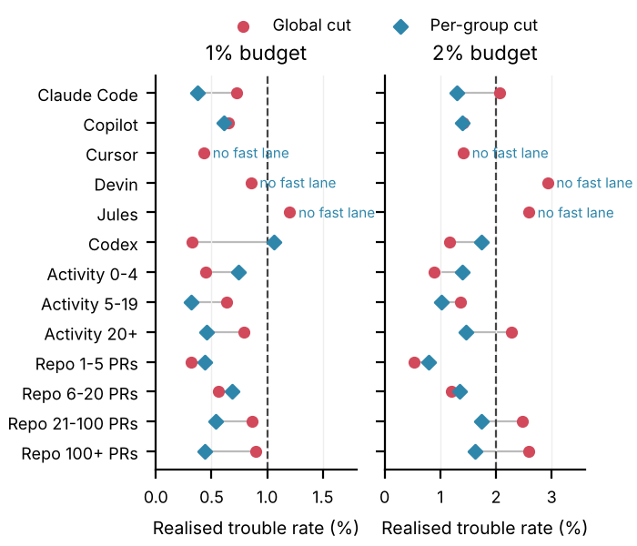

# MergeLane

[](https://github.com/Vc555s/MergeLane/actions/workflows/tests.yml)

**A fast lane for AI-written pull requests, with a guarantee.**

AI coding agents now open more pull requests than many teams can review. MergeLane looks at each PR and sorts it into one of two lanes:

- **Fast lane:** low-risk changes (docs, tests, small safe edits) that can skip the human queue.
- **Human lane:** risky changes, routed to a reviewer with the reason.

The threshold between the lanes comes with a statistical promise, and a monthly check of that promise on your repository's own history. For example: *"Of the PRs we fast-track, at most 1% will need a revert or a follow-up fix."* You choose the percentage.

> Status: v0.3.0. Fast-lane thresholds are now certified separately per agent and per repo activity level. Over five later test months, no group went significantly over a 1% or 2% budget. See [docs/CALIBRATION.md](docs/CALIBRATION.md).

## Results at a glance

Trained on 246,777 merged agent PRs from AIDev and tested on PRs the model never saw.

| Test | Budget | PRs fast-tracked | Realised trouble rate |
|---|---|---|---|
| v0.3 method, check run: train before Oct 2025, test Jan–Feb 2026 | 1% | 15.6% | 0.69% |
| v0.3 method, check run: train before Oct 2025, test Jan–Feb 2026 | 2% | 29.7% | 1.41% |
| 7,676 unseen repositories, one global cut (v0.2 model) | 1% | 25.6% | 0.57% |
| 7,676 unseen repositories, one global cut (v0.2 model) | 2% | 36.4% | 1.79% |
| Five later months, per-group cuts (Oct 2025–Feb 2026) | 1% | 15.4% | 0 groups significantly over budget |
| Five later months, per-group cuts (Oct 2025–Feb 2026) | 2% | 28.5% | 0 groups significantly over budget |

For scale: across all agent PRs in those test months, 12.7% ran into trouble. Against simpler ways of picking the fast lane, under the same per-group calibration and test months ([scripts/baselines_v03.py](scripts/baselines_v03.py)):

| Score used to pick the fast lane | AUC | Fast-tracked at 1% | Fast-tracked at 2% |
|---|---|---|---|
| MergeLane model (v0.3) | 0.776 | 15.6% | 29.7% |
| LightGBM on PR shape only (no diff or code features) | 0.755 | 11.4% | 23.4% |
| Rule: docs/tests-only PRs first, then smallest | 0.745 | 8.4% | 17.4% |
| Rule: smallest change first | 0.725 | 0.0% | 4.1% |

One global cut keeps the promise on average but lets high-risk groups slip (red). Certifying a cut per agent and repo activity brings every group to or under budget within noise (blue), at the cost of a smaller fast lane:



What these numbers do and do not show:
- "Trouble" means reverted, or rewritten by a fix-titled agent PR, within 30 days. Fixes made by humans are not in AIDev, so real trouble is likely higher than measured.
- An LLM judge checked 1,000 of these labels: only about 1 in 4 was a real bug. No human check of that judge has been done yet, and no model we tried can tell real bugs from false alarms.
- The guarantee holds with 90% confidence per group, assuming new PRs look like the last 3 months. The per-group rule was chosen on the same months it was tested on.
- All results are offline replays on AIDev. MergeLane has not yet been run on a live repository with real agent traffic.

Details: [docs/WEEK2.md](docs/WEEK2.md), [docs/STAGE4.md](docs/STAGE4.md), [docs/STAGE5.md](docs/STAGE5.md), [docs/CALIBRATION.md](docs/CALIBRATION.md).

## Use it

Add [examples/mergelane.yml](examples/mergelane.yml) to `.github/workflows/` in your repository:

```yaml
on:
  pull_request:
    types: [opened, synchronize, reopened, ready_for_review]
permissions:
  contents: read
  pull-requests: write
  issues: write
jobs:
  lane:
    runs-on: ubuntu-latest
    steps:
      - uses: Vc555s/mergelane@v0.3.0
        with:
          risk-budget: "0.01"   # 0.01 or 0.02
```

On each PR written by a coding agent (Claude Code, Copilot, Codex, Cursor, Devin or Jules), MergeLane:
- adds the label `mergelane: fast-track` or `mergelane: review`;
- posts one comment, updated on every push, with the predicted trouble chance, the threshold and what the model saw;
- sets the outputs `lane` and `score`, so a later step can act on them.

It never approves or merges. Your team decides what the fast lane means: one reviewer instead of two, or a lighter check. Human-written PRs are left alone.

**Monthly promise check.** With `command: audit` on a schedule, MergeLane finds the PRs it fast-tracked 30 to 120 days ago. It then checks which of them were reverted, or had lines rewritten by a fix PR, within 30 days. The job summary gives the trouble rate, a 90% upper bound, and a verdict: `holds`, `watch`, `not-enough-data` or `breached`. Set `fail-on-breach: "true"` to make a breach fail the job.

Proving a 1% budget needs about 230 fast-tracked PRs, even with zero trouble. Most repos will see `not-enough-data` for a while. Until then, the promise rests on the calibration across AIDev repos.

Try it locally without changing anything on GitHub:

```
pip install lightgbm scikit-learn . && GITHUB_TOKEN=... mergelane check --repo owner/name --pr 123 --dry-run
```

## How it works

1. **Learn what risky looks like** from the `pull_request` table of [AIDev](https://huggingface.co/datasets/hao-li/AIDev) (CC-BY-4.0): 361k agent-written PRs by Codex, Copilot, Devin, Cursor, Jules and Claude Code, of which 246,777 were merged. The label is whether a merged PR was reverted, or had lines it added rewritten by a fix-titled PR, within 30 days. AIDev only contains agent PRs, so fixes made by humans are not seen and the label undercounts trouble.
2. **Score each new PR** with a LightGBM model on what the GitHub API shows for the PR:
   - its shape: file types, size, sensitive paths, description, agent and repo size;
   - what its diff does: added conditions, null checks, error handling, concurrency, auth code, removed asserts and more, counted over every commit's patch;
   - a score from a small model that reads the changed source lines as code tokens.

   With the v0.3 setup, test AUC is 0.776 (check run: train before October 2025, test January to February 2026). The shipped model is then retrained on data up to November 2025. A fine-tuned code transformer added nothing beyond these features ([docs/STAGE4.md](docs/STAGE4.md)).
3. **Calibrate per group** with conformal risk control (Learn-then-Test with a Clopper-Pearson bound) on the last 3 labelled months. A group is an agent combined with how busy the repo is: merged agent PRs in the previous 90 days, banded 0–4, 5–19 or 20+.
   - Each group gets its own cut: the most permissive one whose upper risk bound among fast-tracked PRs stays under the budget.
   - A group without enough data to certify the budget gets no fast lane.
   - At 1% today, that leaves Claude Code and Copilot PRs eligible; at 2%, 11 of 18 groups.
   - The 5% budget was dropped because no rule kept it safe for every group.
4. **Act and check** through the GitHub Action: label, comment and outputs on each PR, plus the monthly promise check on your own history.

## Layout

```
src/mergelane/
  data.py        load AIDev tables (pull requests, commits, files)
  labels.py      revert and follow-up-fix labels
  features.py    submission-time features
  conformal.py   risk-controlled threshold selection
  evaluate.py    time-split evaluation, AUC, fast-track coverage at a risk budget
  rules.py       file-kind, fix-title and line-overlap rules shared by training and the Action
  inference.py   features for one PR from the GitHub API, agent detection, lane decision
  diffstats.py   diff-content counts and code-token text, shared by training and the Action
  audit.py       monthly promise check on a repo's own history
  github.py      small GitHub REST client (standard library only)
  action.py      `mergelane check` and `mergelane audit` (the Action's entry point)
  model/         shipped model (portable.txt), code-token weights (code_tokens.npz), thresholds (portable.json)
action.yml       the GitHub Action
examples/        workflow to copy into your repository
scripts/         data pipeline, experiments and train_portable.py
tests/           unit tests
docs/PLAN.md     evaluation protocol and go/no-go criteria
```

## Prior work this builds on

- AIDev dataset: Hao Li et al., [arXiv 2602.09185](https://arxiv.org/abs/2602.09185)
- Acceptance and review-effort prediction for human and agent PRs on AIDev: [arXiv 2607.12057](https://arxiv.org/abs/2607.12057)
- Follow-up fixes and commit authorship on agent PRs: [arXiv 2609.26847](https://arxiv.org/abs/2609.26847)
- Conformal JIT defect prediction: [MSR 2024](https://2024.msrconf.org/details/msr-2024-technical-papers/33/An-Empirical-Study-on-Just-in-time-Conformal-Defect-Prediction)
- Conformal risk control: Angelopoulos et al., [arXiv 2208.02814](https://arxiv.org/abs/2208.02814)
- Industry evidence: [Vercel, 58% of PRs merge without human review](https://vercel.com/blog/58-percent-of-prs-in-our-largest-monorepo-merge-without-human-review)

## License

MIT (code). AIDev data is CC-BY-4.0; cite the dataset authors.
